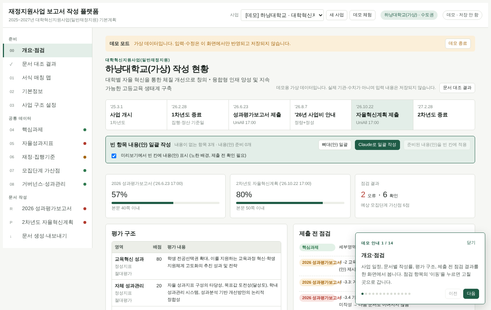
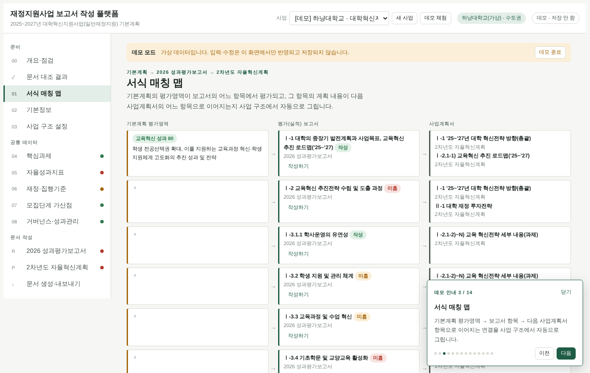
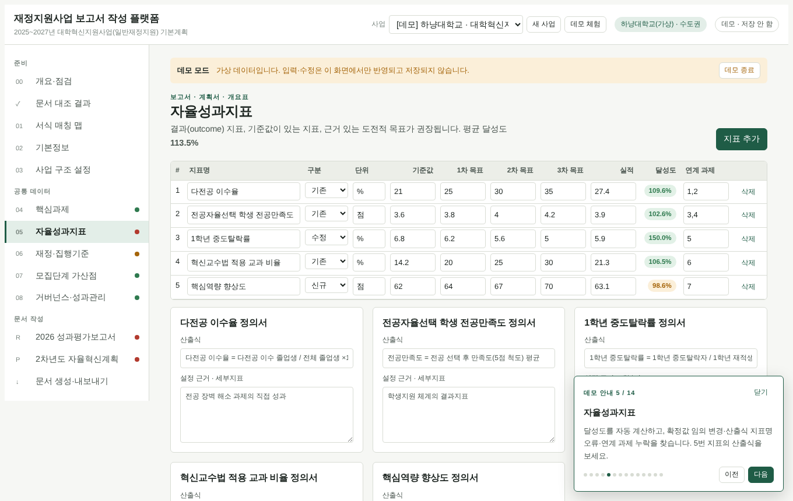
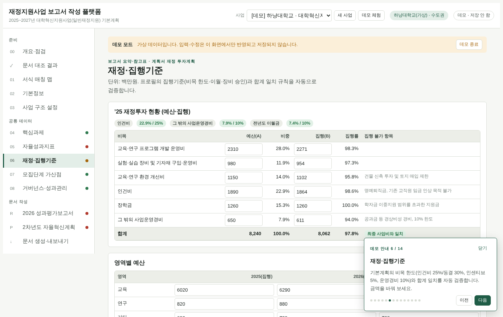
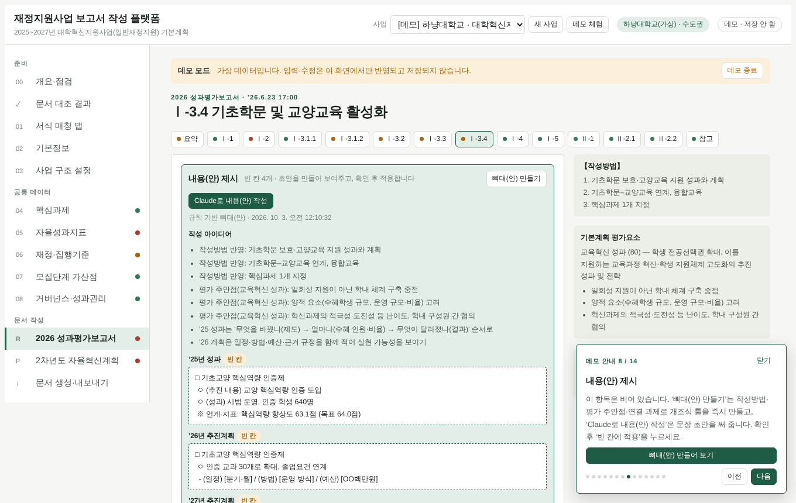
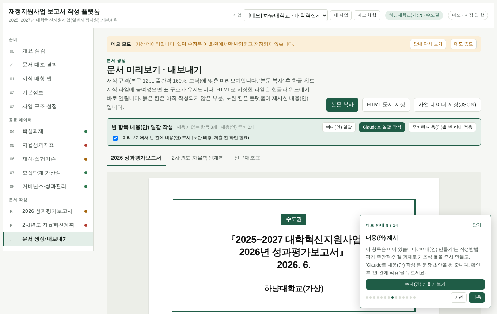
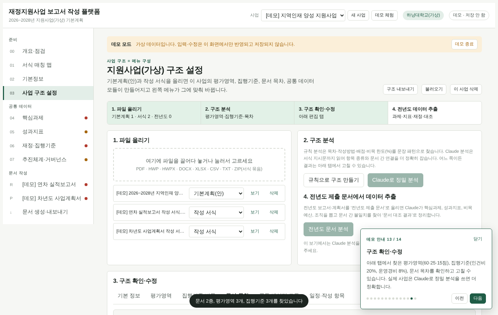

# Platform for Project Reports

**Platform for Project Reports**는 정부 재정지원사업 보고서 작성을 돕는 플랫폼입니다.

> ### 🧪 파일럿(Pilot) 버전 안내
> 이 시스템은 **파일럿 버전**입니다. 실제 업무 적용을 위한 시험 운영 단계이며, 향후 **시스템 사용 환경**(저장 방식, 공동 작업, 기관 내 배포 등)과 **내용**(지원 사업 종류, 서식 해석 정확도, 데이터 추출 범위, 내용(안) 품질 등)을 보완해 계속 디벨롭할 예정입니다. 화면 구성과 기능은 예고 없이 바뀔 수 있습니다.

정부 재정지원사업의 **기본계획(안), 작성 서식, 전년도 제출 문서**를 올리면 사업 구조(평가영역·배점, 사업비 집행기준, 문서 목차·작성방법, 문서 간 연결)를 만들고, 그 구조에 맞춰 **준비 · 공통 데이터 · 문서 작성** 메뉴를 자동으로 구성하는 단일 HTML 플랫폼입니다. 초기 보고서 작성 단계에서 빈 항목에 **작성 아이디어와 내용(안)**을 제시합니다.

## 📂 처음 파일을 올릴 때 — 자료는 최대한 많이

> **보고서 작성에 필요한 자료를 처음에 최대한 많이 올려 주세요.** 올린 자료가 많을수록 사업 구조(목차·평가영역·문서 간 연결)와 공통 데이터(과제·성과지표·예산·조직)가 더 정확하게 잡히고, 항목별 초안(내용(안))도 더 많이 채워집니다.

함께 올리면 좋은 자료:

| 자료 | 초안 구조에 쓰이는 곳 |
|---|---|
| 기본계획(안)·시행계획·공고문 | 평가영역·배점, 평가 주안점, 사업비 집행기준(비목 한도), 일정 |
| 올해 작성 서식(보고서·계획서 양식) | 문서 목차, 항목별 작성방법, 분량 기준, 문서 간 연결 |
| 전년도 제출 보고서(성과평가·실적 보고서) | 과제, 성과지표 기준값·목푯값, 비목 예산, 위원회·조직, 항목별 전년도 원문 |
| 전년도 제출 계획서(사업계획서·수정계획서) | 과제 표기 대조, 계획 항목 원문, 문서 간 불일치 점검 |
| 그 밖의 참고 자료(평가 결과, 내부 계획 등) | 대조·참고용 |

- 여러 파일을 **한 번에** 올리면 됩니다(PDF · HWP · HWPX · DOCX · XLSX · CSV · TXT · ZIP).
- 작성 서식이 없으면 전년도 보고서·계획서의 목차로 구조를 만듭니다. 올해 서식이 바뀌었다면 서식 파일을 꼭 함께 올려 주세요.
- 자동으로 채운 값은 **초안**입니다. ‘문서 대조 결과’와 노란 표시(내용(안))를 확인한 뒤 사용하세요.

## ▶ 웹에서 바로 보기

| 버전 | 파일 | 설명 |
|---|---|---|
| **파일럿 시연판** | `demo.html` | 내장 데이터·템플릿 없이 빈 상태에서 시작. 자료를 올려 구조·데이터가 자동으로 채워지는 과정을 시연 ([웹에서 열기](https://claude.ai/artifact/LHjfkyeZgdZ7ZWC3ZkYLpK)) |
| 전체 버전(데모 포함) | `index.html` | 가상 대학(하냥대학교) 데모·안내 투어와 내장 템플릿(대학혁신지원사업) 포함 ([데모 열기](https://claude.ai/artifact/4QY64heLHXZiTDKcWrXqy4)) |

- 내 PC에서는 `demo.html` 또는 `index.html`을 내려받아 브라우저(Chrome·Edge 권장)로 열면 설치 없이 실행됩니다.
- `index.html`은 처음 열면 데모로 시작합니다(주소 끝 `#demo` → 데모로 시작). 데모에서 입력한 내용은 저장되지 않습니다.

| 개요·점검 | 서식 매칭 맵 |
|---|---|
|  |  |
| **성과지표 자동 점검** | **재정·집행기준 검증** |
|  |  |
| **빈 항목 내용(안) 제시** | **문서 미리보기 (노란 칸 = 내용(안))** |
|  |  |
| **다른 사업: 서식 파일로 구조 만들기** | |
|  | |

## 사용 흐름

1. **새 사업 → 파일만 올려서 바로 시작**에 자료를 한꺼번에 올립니다.
2. 자동 처리 결과를 확인합니다: 사업 구조 → 서식 매칭 맵 → 과제·성과지표·예산·조직 → 항목별 전년도 원문(내용(안)) → 문서 대조 결과.
3. ‘문서 대조 결과’의 불일치(지표값·과제명·예산 합계 등)를 정리하고, 공통 데이터를 확인·수정합니다.
4. 문서 작성 화면에서 내용(안)을 적용·수정합니다(뼈대(안) 또는 Claude 내용(안) 추가 가능).
5. **문서 생성·내보내기**에서 서식 규격 미리보기, 본문 복사(한글·워드 붙여넣기), HTML 저장을 합니다.

## 주요 기능

| 구분 | 내용 |
|---|---|
| 파일 해석 | PDF · HWP · HWPX · DOCX · XLSX/CSV · TXT · ZIP(서식 묶음)을 브라우저에서 직접 읽음 |
| 파일로 자동 채우기 | 올린 자료로 구조(내장 템플릿 자동 인식 또는 목차 분석) → 매칭 맵 → 과제·지표·비목 예산·조직 → 항목별 전년도 원문(내용(안))까지 자동으로 채움. 문서 간 불일치(지표값·과제명·예산 합계)도 찾아냄. Claude 없이 동작하며 빈 곳만 채움 |
| 사업 구조 만들기 | 규칙 분석(목차·작성방법·배점·비목 한도 % 패턴), Claude 정밀 분석(claude.ai 아티팩트에서 실행 시) |
| 매칭 맵 | 기본계획 평가영역 → 평가(실적)보고서 항목 → 차년도 사업계획서 항목 연결을 자동으로 그림 |
| 공통 데이터 | 핵심과제, 성과지표(달성도 자동 계산), 재정(비목 한도·합계·이월·장비 승인), 가산점, 거버넌스 — 한 번 입력하면 여러 문서 표에 반영 |
| 점검 | 과제 지정 개수, 확정값 임의 변경, 산출식 지표명 오류, 비목 편중, 필수 위원 구성, 분량 등 |
| 내용(안) 제시 | 전년도 같은 항목 원문, 뼈대(안)(오프라인), Claude 내용(안) — 확인 후 적용, 빈 항목 일괄 적용 |
| 문서 생성 | 서식 규격(12pt·줄간격 160%·고딕) 미리보기, 본문 복사(한글·워드 붙여넣기), HTML 저장, 신구대조표 |
| 내장 템플릿 | 2025~2027 대학혁신지원사업(일반재정지원) — `index.html`에만 포함 |

## 실행 환경별 차이

| 기능 | 로컬 파일 / GitHub Pages | claude.ai 아티팩트 |
|---|---|---|
| 데이터 저장 | 브라우저 저장소(localStorage, 그 PC·브라우저에만) | `index.html`: 아티팩트 공유 저장소 / `demo.html`: 보는 사람의 브라우저 |
| 파일로 자동 채우기 | 사용 가능 | 사용 가능 |
| Claude 분석·내용(안) | 사용 불가(규칙 분석·뼈대(안)·전년도 원문은 사용 가능) | 사용 가능(보는 사람의 Claude 사용량) |
| 파일 저장 | 브라우저 다운로드 | 저장 확인 창 |
| 파일 해석 라이브러리 | cdnjs에서 필요할 때 불러옴(인터넷 필요) | 동일 |

다른 PC로 옮길 때는 **문서 생성 → 사업 데이터 저장(JSON)** 후 새 환경에서 **사업 구조 설정 → 불러오기**를 사용합니다.

## GitHub Pages로 공개하기

이 저장소에는 GitHub Pages 자동 배포 설정(`.github/workflows/pages.yml`)이 들어 있습니다.

1. 저장소 **Settings → Pages → Build and deployment**에서 Source를 **GitHub Actions**로 고릅니다.
2. `main` 브랜치에 올리면 자동으로 배포되고, **Actions** 탭에서 진행 상황을 볼 수 있습니다.
3. 완료되면 `https://아이디.github.io/저장소이름/`(전체 버전), `…/demo.html`(파일럿 시연판)으로 열립니다.

> 저장소는 Public이어야 하며, `index.html`이 저장소 맨 위에 있어야 합니다(압축을 푼 폴더 **안의 파일**을 올려 주세요).

## 폴더 구조

```
index.html          전체 버전 실행 파일 (데모·내장 템플릿 포함, 이 파일 하나로 동작)
demo.html           파일럿 시연판 (내장 데이터·템플릿 없음, 빈 상태에서 시작)
src/
  01.layout.html    제목·글꼴·스타일(색상 토큰, 라이트/다크)·화면 뼈대
  02.template.js    내장 사업 템플릿(사업 프로필 스키마 예시)
  03.demo.js        데모 데이터·체험용 예시 원문·안내 투어
  04.core.js        유틸, 저장소(db/로컬), 파일 해석, 규칙·Claude 분석, 계산·점검, 문서 생성
  05.draft.js       내용(안) 제시(전년도 원문·뼈대·Claude·일괄)
  055.auto.js       파일로 자동 채우기(템플릿 인식·전년도 표 추출·항목별 원문 연결·문서 대조)
  06.views.js       화면(메뉴는 사업 프로필로 구성)
  07.events.js      이벤트·시작
tools/
  build.js          src → index.html 결합
  build-demo.js     src → demo.html (데모 데이터·템플릿 제외, 공유 저장소 미사용)
docs/screenshots/   README용 화면
.nojekyll           GitHub Pages 원본 그대로 배포
.github/workflows/  GitHub Pages 자동 배포 설정
data/               기관별 자료·내보내기 JSON 보관 위치(.gitignore로 업로드 제외)
```

## 수정 후 다시 만들기

```bash
npm run build        # index.html  (node tools/build.js)
npm run build:demo   # demo.html   (node tools/build-demo.js)
npm run check        # 두 파일 빌드 + 스크립트 문법 검사
```

`src/`의 파일은 이름 순서대로 합쳐집니다. 새 사업 템플릿은 `02.template.js`의 `TEMPLATES`에 프로필 객체를 추가하면 시작 화면에 나타납니다(`demo.html`에는 포함되지 않음).

## 사업 프로필(구조) 요약

```js
{
  programName, planTitle, goal, period, orgLabel, years:{prev,cur,next},
  variantLabel, variants:[...],                 // 예: 권역
  evalAreas:[{id,name,pts,how,desc,focus:[],bonus}],
  rules:[{id,label,kw,max,altMax,altLabel,type:"limit|carry"}],   // 비목 한도
  budgetItems:[...], budgetPlanItems:[...], budgetAreas:[...], equipThreshold,
  modules:{ tasks:{on,label,groups:[{area,sec,n,variant}]}, kpi:{on,label,min,max},
            finance:{on,label}, gov:{on,label,required:[{match,must,label}]}, bonus:{...} },
  docs:[{id,type:"report|plan",name,due,pageLimit,cover:[],
         sections:[{id,no,title,kind:"head|text|pp|auto|derived",src,group,keys,evalArea,guide:[],from:["문서id:항목id"]}]}],
  schedule:[{d,w,s}], ppFields:[{k,l,short}]
}
```

## 유의사항

- 배포용(암호화) HWP와 일부 구형 HWP는 읽지 못합니다. 한글에서 HWPX 또는 PDF로 저장해 올려 주세요. 스캔 이미지 PDF는 글자를 읽지 못합니다.
- 내용(안)은 초기 작성 보조용입니다. 제출 전 수치·사실은 원자료로 확인하고, 생성형 AI를 쓴 경우 서식 안내에 따라 사용 내역을 각주로 적어 주세요.
- 기관 실데이터(기본계획·보고서·계획서 원본 파일, 내보낸 JSON)는 공개 저장소에 올리지 마세요. `data/` 폴더와 PDF·HWP·HWPX·DOCX·XLSX 파일은 `.gitignore`로 업로드에서 제외해 두었습니다.
